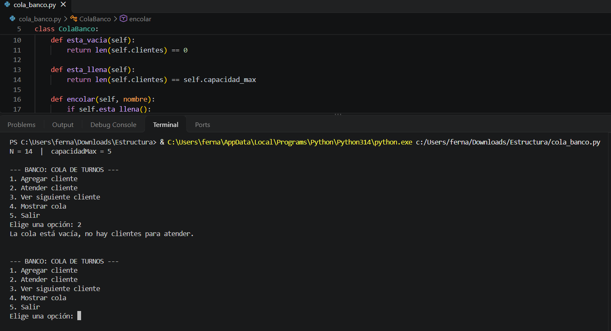
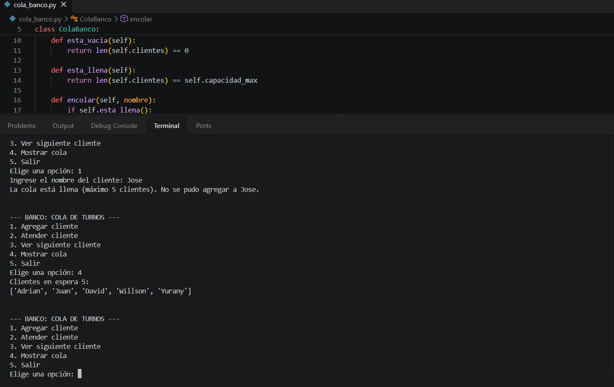
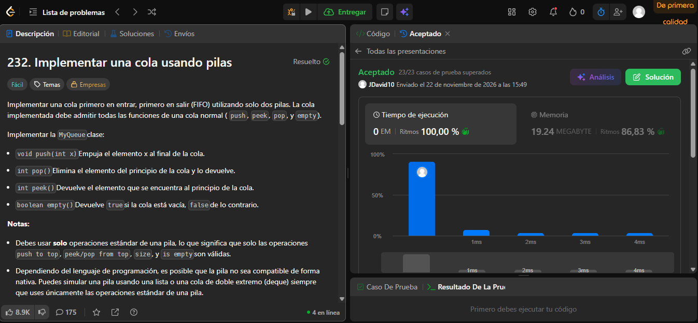
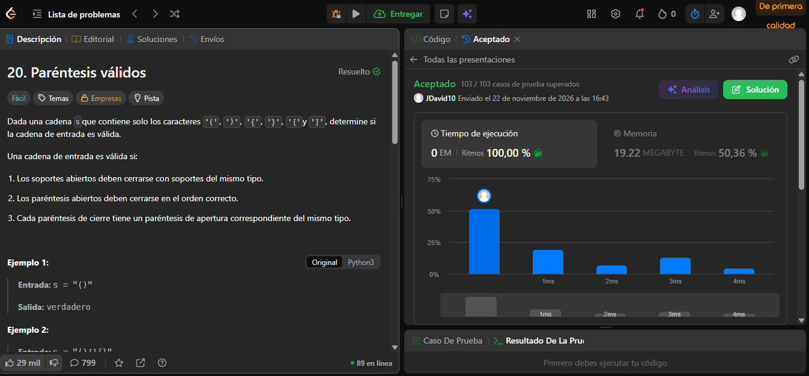

# Taller final – Estructura de Datos

**Corporación Instituto de Administración y Finanzas – CIAF**
Técnica Profesional en Programación de Software

## Integrantes

| # Lista | Apellidos | Nombres |
|---|---|---|
| 14 | Orozco Hernández | Willson Adrián |
| 17 | Prieto Tobón | Juan David |

## Cálculo de N y capacidadMax

En orden alfabético por apellido, el primer integrante es **Orozco Hernández (lista 14)**, así que **N = 14**.

```
capacidadMax = (N mod 4) + 3
capacidadMax = (14 mod 4) + 3
capacidadMax = 2 + 3
capacidadMax = 5
```

14 mod 4 da 2 porque 14 = 4 × 3 + 2: el residuo es 2.

Eso significa que la cola del banco puede tener máximo **5 clientes** esperando a la vez:

- **Overflow:** si llega un sexto cliente, el programa lo rechaza con un mensaje.
- **Underflow:** si se intenta atender a alguien con la cola vacía, el programa muestra un aviso.

## Escenario elegido: Cola de turnos en un banco

En un banco, los clientes llegan, toman un turno y esperan a ser llamados. El orden de atención es importante: el primer cliente en llegar debe ser el primero en ser atendido. Si alguien llega después, no puede pasar antes que los que ya estaban esperando.

### Estructura lineal: Cola (FIFO)

Elegimos una **Cola** porque funciona con el principio **FIFO** (*First In, First Out*: primero en entrar, primero en salir). Esto es justo lo que pasa en el banco: los clientes entran por el final de la fila y salen por el frente cuando los atienden.

Una **Pila** no serviría, porque funciona al revés (LIFO). Con una Pila se atendería primero al último que llegó, lo cual sería injusto para los demás clientes.

### Operaciones principales

| Operación | En el banco | En la cola |
|---|---|---|
| Inserción (encolar) | Un cliente llega y toma turno | Se agrega al final |
| Eliminación (desencolar) | El cajero atiende al siguiente cliente | Se retira del frente |
| Consulta (ver frente) | Ver quién es el próximo en ser atendido | Se mira el frente sin retirarlo |
| Mostrar estado | Ver todos los clientes que están esperando | Se recorre la cola completa |

**Capacidad máxima:** la sala de espera admite máximo **5 clientes** (capacidadMax = 5). Si llega uno más, el sistema lo rechaza (**Overflow**). Si el cajero intenta atender a alguien con la cola vacía, el sistema muestra un aviso (**Underflow**).

## Simulador

El código del simulador está en el archivo [`cola_banco.py`](cola_banco.py).

Para ejecutarlo:

```
python cola_banco.py
```

### Evidencia de ejecución

**Underflow:** se intenta atender un cliente con la cola vacía.



**Overflow:** con 5 clientes en espera, se intenta agregar un sexto cliente.



## Retos LeetCode

### Ejercicio 1: Implement Queue using Stacks

Enlace: <https://leetcode.com/problems/implement-queue-using-stacks/description/>

Código: [`leetcode/implement_queue_using_stacks.py`](leetcode/implement_queue_using_stacks.py)

```python
class MyQueue:

    def __init__(self):
        self.entrada = []
        self.salida = []

    def push(self, x: int) -> None:
        self.entrada.append(x)

    def pop(self) -> int:
        self._traspasar()
        return self.salida.pop()

    def peek(self) -> int:
        self._traspasar()
        return self.salida[-1]

    def empty(self) -> bool:
        return not self.entrada and not self.salida

    def _traspasar(self) -> None:
        if not self.salida:
            while self.entrada:
                self.salida.append(self.entrada.pop())
```



**Análisis de complejidad temporal**

- **push y empty: O(1).** Solo agregan un elemento o revisan si las listas están vacías, sin importar cuántos elementos haya.
- **pop y peek: O(n) en el peor caso**, cuando la salida está vacía y hay que traspasar los n elementos de entrada. Como cada elemento se traspasa una sola vez, en promedio (amortizado) cada operación cuesta **O(1)**.

**Análisis de complejidad espacial**

**O(n).** Entre las dos pilas se almacenan como máximo los n elementos que están en la cola. No se usa memoria adicional que crezca con la cantidad de datos.

### Ejercicio 2: Valid Parentheses

Enlace: <https://leetcode.com/problems/valid-parentheses/description/>

Código: [`leetcode/valid_parentheses.py`](leetcode/valid_parentheses.py)

```python
class Solution:
    def isValid(self, s: str) -> bool:
        pila = []
        pares = {')': '(', ']': '[', '}': '{'}

        for c in s:
            if c in pares:
                if not pila or pila[-1] != pares[c]:
                    return False
                pila.pop()
            else:
                pila.append(c)

        return not pila
```



**Análisis de complejidad temporal**

**O(n)**, donde n es la longitud del texto. El texto se recorre una sola vez, y en cada paso se hace una cantidad fija de trabajo: consultar el diccionario, mirar el tope, agregar o quitar de la pila. Cada una de esas operaciones tarda lo mismo sin importar el tamaño de la pila. Si el texto fuera el doble de largo, el trabajo sería aproximadamente el doble.

**Análisis de complejidad espacial**

**O(n).** En el peor caso todos los símbolos son de apertura (por ejemplo `"((((("`), y la pila debe guardar los n. El diccionario siempre tiene tres elementos, por lo que su tamaño es constante y no afecta el resultado.

## Estructura del repositorio

```
├── 05. Taller final - Estructura de datos.docx
├── README.md
├── cola_banco.py
└── imagenes/
    ├── underflow.png
    ├── overflow.png
    ├── leetcode_implement_queue.png
    └── leetcode_valid_parentheses.png
```
